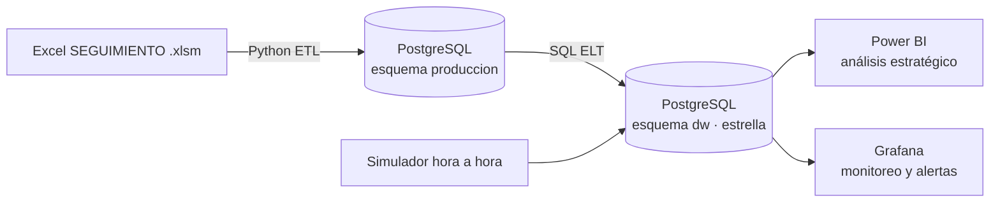

# BI de paros de producción y OEE – Líneas de envasado de vinilos

Solución de Inteligencia de Negocios de extremo a extremo para una fabricante de vinilos y témperas con cuatro líneas de envasado (Vinilos_1 a Vinilos_4). Integra el histórico de producción y paros (2022-01-01 a 2025-03-28) en un modelo dimensional sobre PostgreSQL, con ETL reproducible y validación de calidad de datos, y lo expone en Power BI (análisis estratégico) y Grafana (monitoreo operativo con alertas).

**Integrantes:** [Nombre Apellido 1] · [Nombre Apellido 2]  
**Curso:** Business Intelligence · **Entrega:** [fecha]

## Estado del proyecto
| Componente | Estado |
|---|---|
| Esquema relacional de origen (`produccion`) | Hecho |
| ETL Excel → PostgreSQL, conciliado | Hecho |
| Modelo dimensional (`dw`) y consultas analíticas | Hecho |
| Tablero Power BI | En progreso |
| Simulador y tablero Grafana con alerta | Pendiente |
| Despliegue con Docker (bonificación) | Pendiente |

## Arquitectura


## Estructura del repositorio
| Carpeta | Contenido |
|---|---|
| `sql/` | Scripts numerados en el orden de ejecución |
| `etl/` | `etl_paros.py` (extracción, limpieza, carga) y `totales_excel.py` (totales de control) |
| `powerbi/` | Proyecto `.pbip` y `medidas_powerbi.dax` |
| `grafana/` | Tablero exportado y provisioning |
| `docs/` | Diagramas y capturas |
| `data/` | Vacía: aquí se copia el Excel (no se versiona) |

## Reproducir desde cero
Requisitos: PostgreSQL 14+, Python 3.10+, Power BI Desktop.

1. **Base de datos.** Crear la base `SEGUIMIENTO_TEMPERAS_Y_VINILOS` (por ejemplo con pgAdmin o DBeaver).
2. **Esquema y maestros.** Ejecutar en orden `sql/01_schema_produccion.sql` y `sql/02_maestros_produccion.sql`.
3. **Configuración.** Copiar `.env.example` a `.env` y poner la contraseña real. Definir la variable `PG_DSN` en la terminal (PowerShell: `$env:PG_DSN="host=localhost port=5432 dbname=SEGUIMIENTO_TEMPERAS_Y_VINILOS user=postgres password=..."`).
4. **Datos de origen.** Copiar el Excel `SEGUIMIENTO_TEMPERAS_Y_VINILOS_Actividad.xlsm` a `data/`.
5. **ETL.**
   ```bash
   pip install -r etl/requirements.txt
   python etl/etl_paros.py --archivo data/SEGUIMIENTO_TEMPERAS_Y_VINILOS_Actividad.xlsm --dry-run   # valida sin escribir
   python etl/etl_paros.py --archivo data/SEGUIMIENTO_TEMPERAS_Y_VINILOS_Actividad.xlsm             # carga
   ```
   La carga es idempotente (se puede repetir sin duplicar). Resultado esperado: `4952 registros OK, 1 con error, 14653 paros insertados`.
6. **Modelo dimensional.** Ejecutar en orden `sql/03_dw_modelo_dimensional.sql`, `04_dw_carga.sql`, `05_vista_tasa_ideal.sql` y `06_marcar_atipicos.sql`.
7. **Conciliación.** `python etl/totales_excel.py data/<archivo>.xlsm` y comparar con las consultas de validación (ver tabla abajo).
8. **Consumo.** Abrir el proyecto de `powerbi/` y apuntar a la base; importar las medidas de `powerbi/medidas_powerbi.dax`.

## Conciliación ETL contra el Excel
| Control | Excel | Base de datos | Diferencia | Causa |
|---|---|---|---|---|
| Horas de paro | 8.449,7 | 8.431,5 | 18,2 | 1 registro rechazado por el trigger de duración |
| Horas trabajadas | 38.063,4 | 38.052,9 | 10,5 | el mismo registro |
| Pacas producidas | 378.778 | 378.745 | 33 | el mismo registro |

## Modelo dimensional
Estrella con tres hechos y siete dimensiones.

| Hecho | Grano |
|---|---|
| `fact_produccion_turno` | máquina × fecha × turno × operario × referencia |
| `fact_paro` | un paro (registro × causa × subcódigo × agente) |
| `fact_produccion_hora` | máquina × hora (alimentada por el simulador) |

Dimensiones: `dim_fecha` (construida), `dim_maquina`, `dim_turno`, `dim_referencia`, `dim_operario` (con código seudónimo), `dim_agente` y `dim_causa_paro` (jerarquía Área → Código → Subcódigo, preparada para SCD Tipo 2).

## Definición de indicadores
- **Disponibilidad** = 1 − minutos de paro / (horas trabajadas × 60). Coincide con la «productividad» que hoy reporta el Excel (validado contra el procedimiento P-MTO-22).
- **Rendimiento** = producción real (tope 100 % por registro, sin atípicos) / producción ideal. La tasa ideal es el percentil 90 de pacas por hora de marcha por máquina y referencia: **es un proxy**, porque el Excel no guarda la meta histórica.
- **Calidad:** no se calcula; el Excel no registra unidades no conformes. Por eso se reporta **OEE sin Calidad**.

## Hallazgos de calidad de datos
- 8.208 filas se funden en 4.953 registros (las filas «Ingreso subcódigo» pertenecen al mismo turno).
- 2022 y gran parte de 2023 no traen turno ni operario; 2.374 registros sin referencia.
- 945 subcódigos no corresponden a su código de paro.
- 82 registros tienen más paro que horas trabajadas.
- 10 registros producen más de 3 veces su ideal (seis de Vinilos_1 en julio de 2023, ≈14 % de las pacas): se marcan con `es_atipico`.

## Seguridad y datos personales
- No hay contraseñas ni cadenas de conexión en el repositorio: se leen de variables de entorno (`.env` ignorado, `.env.example` versionado).
- Los nombres de operarios no se llevan a los tableros: se usa un código seudónimo (`OP-0001`). El personal de mantenimiento no se incorpora al modelo.
- El Excel de origen no se versiona.
